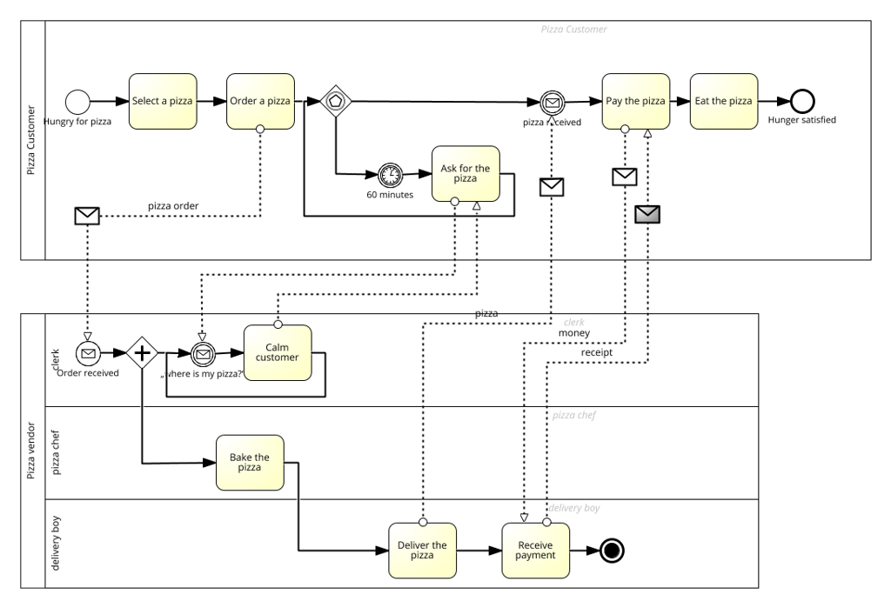

# TODO

---

## Requirements

### Base
- [ ] implement the provided by the customer business process
- [ ] use pools and lanes
- [x] create test users and appropriate roles
- [ ] Implement Pizza Ordering Web Portal (use HTML Dialog)
- [ ] customer should be able to select and order pizza from a catalog.
- [ ] customer needs to provide pizza choice and delivery address
- [ ] Implement Internal Pizza Management Portal
- [ ] Administrators can mange Pizza catalog (CRUDL)
- [ ] Pizza staff should be able to see the pizza order details
- [ ] delivery staff should be able to see delivery address
- [ ] Implement DataBase
- [x] create Pizza catalog data model
- [x] create Pizza orders data model
- [ ] use AxonIvy mailing features for notifications
### PP1
- [ ] a user shall see all available pizzas.
- [ ] those pizzas shall be presented with a picture, description, price.
- [ ] a user can search or filter pizzas, depending on name or price.
- [ ] it must be possible to choose the ordering amount and add a item to the chart.
### PP2
- [ ] a user can browse its cart.
- [ ] it shows a total in price.
- [ ] Items can still be removed or increased.
- [ ] the cart can be checked out, in order to bill and deliver.
### PP3
- [ ] a user can log into the app.
- [ ] User can see their account details.
- [ ] a logged user receives 10 % discount on orders.
### PP4
- [ ] on the checkout order integrate the API of the POST. It shall fetch ZIP based on the entered city Name. (openplzapi.org)
### PP5
- [ ] when a Pizza is created, delivery needs to be triggered.
- [ ] Use Axon Ivy User Task to track deliveries.
- [ ] assign them to the 3 Delivery Roles (West, East, Middle) the roles shall be identified using decision tables. based on ZIP (  < 3000 = West, < 8000, rest = East)
### PP6
- [ ] the data generated is persisted in a database.
### PP7
- [ ] Pizzas can be managed over a own process
### Opptional
- [ ] Use Hibernate to persists the pizza catalog and store the orders
- [ ] create mock web service for simulating CRM system for storing the users there
- [ ] integrate the process with this mock web service
- [ ] Implement reporting module
- [ ] Improve the UI/UX of the Pizza Ordering view
- [ ] Implement Administration module for managing the Pizza catalog - CRUD operations
- [ ] Implement Smart-Workflow

---

## Roadmap
| # | Feature | Covers | Planned Ivy built-in |
|---|---------|--------|----------------------|
| F0 | Foundation: roles, test users, data classes | Base: roles/users, data models | `roles.yaml`, `users.yaml`, data classes (Pizza, OrderItem, Order, Address) |
| F1 | Process skeleton (pools/lanes, empty tasks, runs end-to-end) | Base: business process, pools & lanes | Process editor: User Tasks, Task Switch Gateway, Signal/Trigger |
| F2 | Pizza catalog + seed data | PP6, data model | Business Data (`ivy.repo`), seed start |
| F3 | Admin CRUDL as its own process | PP7, Base: admin manages catalog | Form Editor (generated from data class) |
| F4 | Select pizza: catalog list, picture, search/filter, amount, add to cart | PP1 | Form Editor DataTable + IvyScript filter |
| F5 | Cart & checkout with delivery address | PP2, Base: pizza choice + address | Form Editor, Order saved via Business Data |
| F6 | Bake → deliver → receive payment (worker lanes) | Base: chef sees order, delivery sees address | User Tasks + forms, role-based responsibility |
| F7 | Delivery region by ZIP (West/Middle/East) | PP5 | Decision table if Ivy 14 has one, otherwise an Alternative gateway |
| F8 | "Where is my pizza?" (60 min timer → ask → clerk calms) | Base: process | Timer intermediate event, Signal |
| F9 | Mail notifications | Base: mailing | E-Mail process element + local dev SMTP |
| F10 | Login + 10 % discount, account details | PP3 | Portal login/profile, `ivy.session` check in IvyScript |
| F11 | City → ZIP lookup | PP4 | REST Client (`rest-clients.yaml`) + REST activity |
| F12 | Portal polish (case/task names, custom fields, dashboard) | "make it look good" | Portal configuration |
